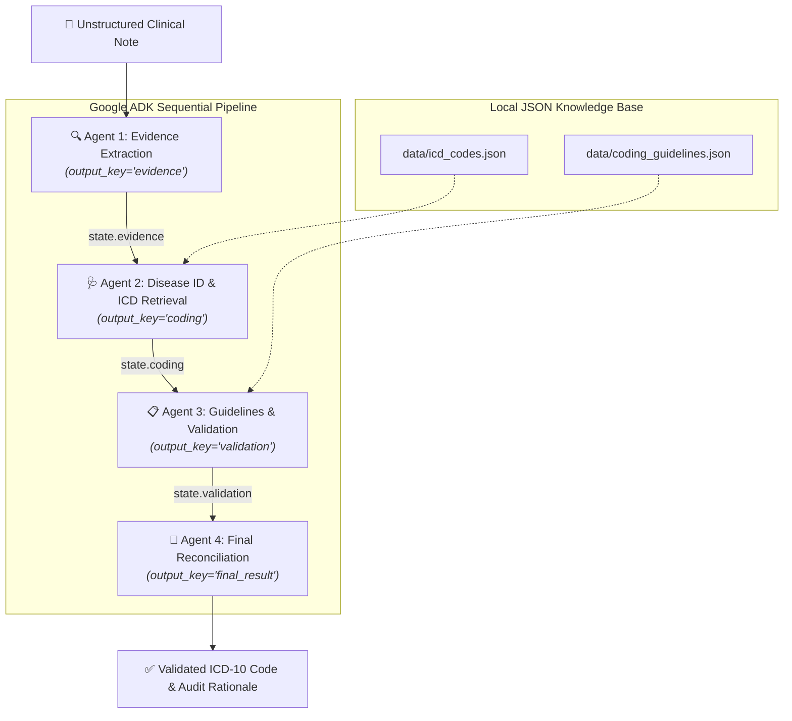

<div align="center">

# 🩺 Medical Coding: Code Like Humans (CLH)

### *A Next-Gen Multi-Agent Medical Coding Engine Powered by Google ADK & Gemini 3.6 Flash*

[](https://python.org)
[](https://google.github.io/adk-docs/)
[](https://ai.google.dev/)
[](LICENSE)
[](README.md)
[](README.md#-ground-truth-evaluation)

<p align="center">
  <b>Automating ICD-10 medical coding by imitating the procedural cognitive workflow of certified human clinical coders.</b>
</p>

[🚀 Quick Start](#-quick-start) •
[🌟 Why CLH?](#-why-code-like-humans) •
[🏗️ Architecture](#-system-architecture) •
[💻 Usage Modes](#-usage--execution-modes) •
[🌐 ADK Web Studio](#-adk-web-developer-studio) •
[📊 Benchmark](#-ground-truth-evaluation) •
[⚠️ Disclaimer](#-clinical-disclaimer)

</div>

---

## 🌟 Why "Code Like Humans"?

Medical coding is the critical bridge between clinical care, hospital administration, and billing. Converting unstructured Electronic Health Records (EHR) into standardized **ICD-10-CM diagnostic codes** is notoriously complex.

### ❌ The Problem with Single-Prompt LLMs & Traditional RAG
* **Hallucinated ICD Codes**: Single LLM prompts often invent non-existent codes or misapply billing rules.
* **Opacity & Black-Box Decisions**: No transparent audit trail explaining *why* a code was selected.
* **Complexity Overflow**: Asking a single model to parse clinical notes, consult code tables, and validate medical rules simultaneously leads to high error rates and cognitive overload.

### ✅ The Solution: Multi-Agent Procedural Cognition
**Code Like Humans (CLH)** solves this by mirroring the exact step-by-step reasoning of certified human medical coders:
1. **Extract Evidence** ➔ 2. **Match ICD Code** ➔ 3. **Audit Against Rules** ➔ 4. **Reconcile Final Code**

Built **100% natively on the Google Agent Development Kit (ADK)** and powered by **Gemini 3.6 Flash**, CLH delivers deterministic precision, zero RAG overhead, and complete transparency.

---

## ✨ Key Features & Technical Highlights

* 🧠 **Human-Cognitive 4-Agent Pipeline**: Decomposes coding into a strictly sequential multi-agent workflow where each agent specializes in one specific phase of clinical reasoning.
* ⚡ **100% Native Google ADK Architecture**: Zero heavy framework bloat (no LangChain, CrewAI, or AutoGen). Uses ADK `LlmAgent`, `SequentialAgent`, and state propagation.
* 🎯 **Zero RAG / Deterministic Accuracy**: Queries curated local JSON codebooks (`icd_codes.json` & `coding_guidelines.json`) for fast, transparent, and reproducible code retrieval.
* 🌐 **Built-in ADK Web Developer Studio**: Out-of-the-box compatibility with `adk web agents` to visually inspect trace trees, session state variables, and per-agent reasoning steps.
* 📊 **Rigorous Local Evaluation Suite**: Automated benchmark framework evaluating 200 synthetic clinical cases with local Accuracy, Precision, Recall, and F1-Score metrics.
* 🛡️ **Free-Tier API Resilience**: Built-in exponential backoff rate-limit handling ensuring smooth execution even under Gemini API free-tier quotas.

---

## 🏗️ System Architecture

The pipeline processes unstructured clinical notes through four specialized sequential agents using Google ADK session state key chaining:



### 🤖 The 4 Specialized Agents

| Agent | Core Responsibility | Input State | Output Key | Role Description |
| :--- | :--- | :--- | :--- | :--- |
| **Agent 1: Evidence Extraction** | Clinical Information Parsing | Raw EHR Text | `evidence` | Extracts structured symptoms, diagnoses, treatments, medical history, and lab findings. |
| **Agent 2: Disease ID & ICD Retrieval** | Condition & Code Matching | `state.evidence` | `coding` | Matches extracted evidence against local ICD lookup data (`icd_codes.json`). |
| **Agent 3: Guidelines & Validation** | Compliance & Rule Audit | `state.coding` | `validation` | Audits proposed codes against medical coding guidelines (`coding_guidelines.json`). |
| **Agent 4: Final Reconciliation** | Final Audit & Output Synthesis | `state.validation` | `final_result` | Synthesizes validation results and produces a transparent clinical rationale. |

---

## 📁 Project Structure

```text
medical-coding-clh/
│
├── agents/                           # Google ADK Native Multi-Agent System
│   ├── config.py                     # Global model config (Gemini 3.6 Flash) & env overrides
│   ├── evidence_agent.py             # Agent 1: Evidence Extraction Agent
│   ├── disease_icd_agent.py          # Agent 2: Disease Identification & ICD Retrieval Agent
│   ├── guidelines_agent.py           # Agent 3: Coding Guidelines & Validation Agent
│   ├── reconciliation_agent.py       # Agent 4: Final Reconciliation Agent
│   ├── root_agent.py                 # Root ADK SequentialAgent orchestrator
│   └── agent.py                      # Entrypoint alias for ADK Web Developer Studio
│
├── data/                             # Local Knowledge Base & Benchmark Dataset
│   ├── icd_codes.json                # Local ICD-10 lookup database (25+ common conditions)
│   ├── coding_guidelines.json        # Local coding guidelines & diagnostic edge rules
│   ├── clinical_dataset.csv          # Benchmark dataset (200 synthetic clinical cases)
│   └── evaluation_results.json       # Ground-truth evaluation metrics & trace report
│
├── evaluation/                       # Ground-Truth Benchmark Engine
│   └── evaluate.py                   # Local evaluation script (Accuracy, Precision, Recall, F1)
│
├── app/                              # Application Interface
│   └── main.py                       # CLI & Interactive Menu interface
│
├── .env                              # Environment configuration (GEMINI_API_KEY)
├── requirements.txt                  # Lightweight project dependencies
└── README.md                         # Project Documentation & Marketing Guide
```

---

## 🚀 Quick Start

### 1. Prerequisites
- **Python 3.11+**
- A **Gemini API Key** (Get one free from [Google AI Studio](https://aistudio.google.com/))

### 2. Installation

Clone the repository and set up the local virtual environment:

```bash
# 1. Clone the repository
git clone https://github.com/borrakrishnaprasanth/medical-coding-clh.git
cd medical-coding-clh

# 2. Create and activate virtual environment
python -m venv .venv

# On Windows (PowerShell):
.venv\Scripts\Activate.ps1

# On Linux / macOS:
source .venv/bin/activate

# 3. Install dependencies
pip install -r requirements.txt
```

### 3. Environment Setup

Create a `.env` file in the project root directory:

```env
GEMINI_API_KEY=YOUR_GEMINI_API_KEY_HERE
```

---

## 💻 Usage & Execution Modes

### Mode 1: Interactive Menu Interface
Launch the interactive CLI dashboard to test custom notes, inspect lookup tables, or launch benchmarks:

```bash
python app/main.py
```

```text
================================================================================
          MEDICAL CODING: CODE LIKE HUMANS (GOOGLE ADK & GEMINI)
   Sequential Multi-Agent Pipeline for Unstructured Clinical Note Coding
================================================================================

--- MAIN MENU ---
1. Process Single Clinical Note (Mode 1)
2. Run Local Dataset Evaluation (Mode 2)
3. View Local ICD Table & Coding Guidelines
4. Exit
```

---

### Mode 2: Direct CLI Flag Execution
Process any clinical note directly via command-line flags:

```bash
python app/main.py --note "Patient presents with persistent polyuria, polydipsia, and fasting blood glucose of 185 mg/dL. Diagnosed with Type 2 Diabetes Mellitus."
```

#### Example Output:
```json
================================================================================
                           FINAL CODING RESULT
================================================================================
Final Diagnosis  : Type 2 Diabetes Mellitus
Final ICD Code   : E11.9
Validation Status: validated
Explanation      : The diagnosis of Type 2 Diabetes Mellitus without complications (E11.9) is fully validated by clinical findings of polyuria, polydipsia, and an elevated fasting blood glucose level of 185 mg/dL.
================================================================================
```

---

## 🌐 ADK Web Developer Studio

Experience real-time visual agent orchestration with Google ADK's native Web UI:

```bash
adk web agents
```

1. Open your browser at **`http://127.0.0.1:8000`**
2. Click **NEW SESSION**
3. Type or paste any clinical note in the prompt box
4. Watch the 4 agents execute step-by-step in real-time, displaying session state propagation (`state.evidence`, `state.coding`, `state.validation`, `state.final_result`)!

---

## 📊 Empirical Evaluation & Benchmark Suite

The project includes an automated benchmark framework evaluating against a test set of **200 synthetic clinical notes** across 25 distinct medical conditions and diagnostic edge cases ([`data/clinical_dataset.csv`](data/clinical_dataset.csv)).

> 🔒 **Zero Data Contamination**: Ground-truth labels (`ground_truth_disease`, `ground_truth_icd`) are strictly isolated and hidden from agents during execution. Metrics are computed locally without relying on LLM-as-a-Judge.

### 🧪 1. Feasibility Pilot Results ($n=3$)

An initial feasibility evaluation was logged in [`data/evaluation_results.json`](data/evaluation_results.json):

| Metric | Pilot Score ($n=3$) | Description |
| :--- | :---: | :--- |
| 🎯 **Accuracy** | **100.00%** | Exact match rate between `final_icd_code` and ground-truth ICD |
| 📐 **Macro Precision** | **100.00%** | Unweighted mean precision on evaluated cases |
| 🔄 **Macro Recall** | **100.00%** | Unweighted mean recall on evaluated cases |
| ⚡ **Macro F1-Score** | **100.00%** | Harmonic mean of precision and recall |
| ⏱️ **Mean Latency** | **3.13s** | Average end-to-end execution time per note across the 4-agent pipeline |

### 🚀 2. Running Scaled 200-Case Evaluation & Baselines

You can run the full multi-agent benchmark and the fair single-prompt zero-shot ablation baseline:

```bash
# Run 4-Agent Pipeline benchmark on 10 cases (or set --limit 200 for full suite)
python evaluation/evaluate.py --limit 10 --delay 1.0

# Run Fair Single-Prompt Baseline (with full ICD codebook and guidelines access)
python evaluation/ablation_single_prompt.py --limit 10 --delay 1.0

# Run complete orchestrated benchmark suite
python evaluation/run_full_benchmark.py
```

### ⚠️ Benchmark Limitations
The 200 cases in `data/clinical_dataset.csv` are synthetic clinical vignettes designed for controlled diagnostic boundary testing. They do not simulate the multi-label co-morbidities or documentation ambiguities of large-scale inpatient repositories (e.g., MIMIC-IV). Results reflect controlled feasibility rather than open-world EHR coding.

---

## ⚠️ Clinical Disclaimer

> **IMPORTANT NOTICE: EDUCATIONAL & RESEARCH PROTOTYPE ONLY**
> 
> This repository is an **educational research prototype** inspired by agentic AI clinical coding research. It is designed exclusively for demonstration, software engineering analysis, and educational testing.
> 
> It is **NOT** intended for clinical use, medical decision-making, hospital billing submission, or as a replacement for certified professional medical coders or licensed healthcare providers.

---

## 📜 License

Distributed under the **MIT License**. See `LICENSE` for details.

---

## 🙏 Acknowledgements

* **Google DeepMind & Google ADK Team** for the outstanding [Google Agent Development Kit](https://google.github.io/adk-docs/).
* **Google Gemini 3.6 Flash** for fast, high-reasoning multimodal capabilities.
